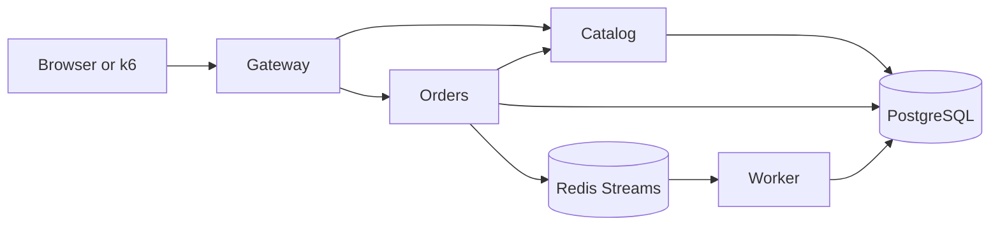

# SRE Reliability Lab

SRE Reliability Lab is a reproducible Kubernetes portfolio environment for practicing service-level objectives, telemetry correlation, actionable alerting, capacity analysis, bounded fault injection, incident response, and disaster recovery.

The implementation is intentionally evidence-driven: performance and reliability claims are documented only after a repeatable test or drill produces an artifact.

> The application, platform, and lab exercises are delivered through milestone pull requests. See the repository pull requests for the implementation history.

## Reference application

The lab models a small order system with a synchronous critical path and an asynchronous fulfillment path:



This gives the lab observable failure modes in HTTP dependencies, database connections, queue backlog, worker throughput, and Kubernetes scheduling without hiding the application behind a demo stack.

## Application quick start

Prerequisites: Docker with Compose, Node.js 24, and npm.

```bash
npm ci
make compose-up
make smoke
```

Open <http://localhost:8080> to create an order. Stop the foundation with `make compose-down`. The detailed Kubernetes bootstrap is added in the platform milestone.

Useful checks:

```bash
make check
npm run build
docker compose logs -f gateway orders worker
```

The development password in `compose.yaml` is intentionally local-only. Kubernetes secrets and cloud values must replace it outside Compose.

## Safety

Fault injection is disabled by default and may run only against the lab's explicitly marked disposable kind cluster. Never use the lab's chaos commands against production or an unknown Kubernetes context.

No uptime, capacity, recovery, or alert-quality claim in this repository should be treated as measured unless its evidence records a timestamp, environment, workload, and git SHA.

## License

Apache-2.0.
