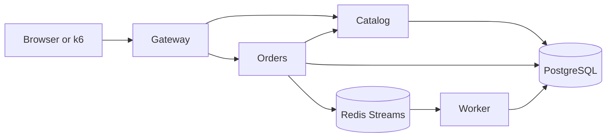

# SRE Reliability Lab

SRE Reliability Lab is a reproducible Kubernetes portfolio environment for practicing service-level objectives, telemetry correlation, actionable alerting, capacity analysis, bounded fault injection, incident response, and disaster recovery.

The implementation is intentionally evidence-driven: performance and reliability claims are documented only after a repeatable test or drill produces an artifact.

> The application, platform, and lab exercises are delivered through milestone pull requests. See the repository pull requests for the implementation history.

## Reference application

The lab models a small order system with a synchronous critical path and an asynchronous fulfillment path:



This gives the lab observable failure modes in HTTP dependencies, database connections, queue backlog, worker throughput, and Kubernetes scheduling without hiding the application behind a demo stack.

## Application quick start

Prerequisites: Docker with Compose, Node.js 24, and npm.

```bash
npm ci
make compose-up
make smoke
```

Open <http://localhost:8080> to create an order. Stop the foundation with `make compose-down`.

## Kubernetes quick start

With Docker, kubectl, Helm 3, Node.js 24, and npm installed:

```bash
npm ci
make tools       # installs checksum-verified kind v0.32.0 under .tools/
make bootstrap   # creates only kind-sre-reliability-lab and runs the smoke journey
make observability-access  # Grafana :3000 and Prometheus :9090
make teardown
```

The gateway is available at <http://localhost:8080>. `make teardown` refuses to run unless the active context is exactly `kind-sre-reliability-lab`.

Grafana uses the local-only credentials `admin` / `admin-local-only`. Bootstrap installs Prometheus, Alertmanager, Grafana, Loki, Tempo, kube-state-metrics, node/container metrics, and OpenTelemetry Collector gateway/agent pipelines before emitting smoke-test telemetry.

Useful checks:

```bash
make check
npm run build
docker compose logs -f gateway orders worker
```

## Reliability exercises

Load profiles write ignored raw results with metadata; promote only reviewed aggregates into `evidence/`:

```bash
make load PROFILE=smoke
RATE=2 DURATION=5m make load PROFILE=baseline
```

Chaos is absent from bootstrap and requires the full acknowledgement on both installation and execution:

```bash
CHAOS_ACK=I_UNDERSTAND_SRE_LAB_IS_DISPOSABLE make chaos-install
CHAOS_ACK=I_UNDERSTAND_SRE_LAB_IS_DISPOSABLE \
  make chaos-run EXPERIMENT=pod-termination
```

Backup and restore use a separate restore StatefulSet/PVC:

```bash
make backup
make restore BACKUP=/absolute/path/printed/by/backup.dump
```

## Documentation

- [Architecture](docs/architecture.md) and [telemetry flow](docs/telemetry.md)
- [SLOs and alert policy](docs/slo.md) plus [runbooks](runbooks/)
- [Capacity methodology](docs/capacity.md) and [bounded chaos](docs/chaos.md)
- [Incident process](docs/incident-process.md) and [disaster recovery](docs/disaster-recovery.md)
- [Interview demo](docs/interview-demo.md), [evidence policy](evidence/README.md), and [limitations](docs/limitations.md)

The development password in `compose.yaml` is intentionally local-only. Kubernetes secrets and cloud values must replace it outside Compose.

## Safety

Fault injection is disabled by default and may run only against the lab's explicitly marked disposable kind cluster. `make chaos-guards` proves missing acknowledgement, context, cluster, or namespace-label checks fail without injecting a fault. Never use the lab's chaos commands against production or an unknown Kubernetes context.

No uptime, capacity, recovery, or alert-quality claim in this repository should be treated as measured unless its evidence records a timestamp, environment, workload, and git SHA.

## License

Apache-2.0.
